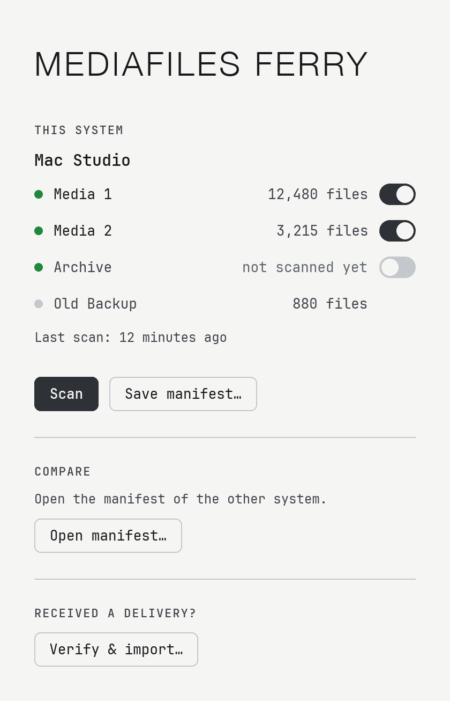
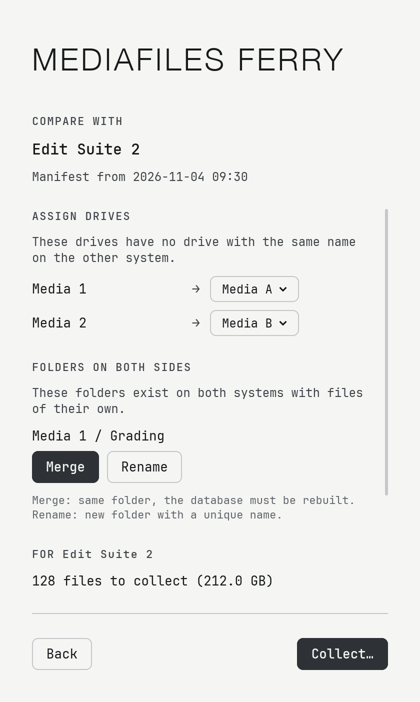
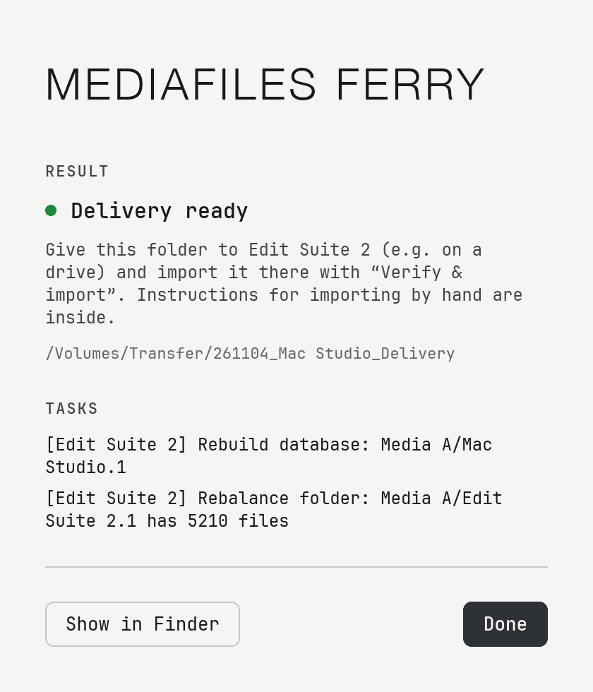

# MediaFiles Ferry

Keeps the Avid media files (`Avid MediaFiles/MXF`) of several edit systems in sync – without the systems being connected.

Ferry scans the MXF folders with checksums, compares two systems through a small manifest file, collects the missing files into a delivery folder and safely imports that folder on the other system. It respects the Avid databases (`msmFMID.pmr`, `msmMMOB.mdb`) and lists everything that has to be done by hand in a task list.

*Deutsch: Die App gibt es auch auf Deutsch – MediaFiles Ferry → Settings… → Language.*

Updates install from within the app (Settings… → Check for updates, or the notice at the top of the window).

<p align="center"><picture><source media="(prefers-color-scheme: dark)" srcset="assets/screenshots/home-dark.png"></picture></p>

> **Beta.** MediaFiles Ferry 1.0 is a beta. Please report problems in [Issues](../../issues).

## How it works

1. **Scan** each system. Ferry records every MXF file with a checksum and saves a *manifest* – a list of files, no media.
2. **Exchange** the manifests, e.g. by e-mail or USB stick.
3. **Compare & collect:** open the other system's manifest. Ferry shows what is missing over there and collects it into a delivery folder.
4. **Verify & import** the delivery on the other system. Ferry verifies every file first and only imports a complete delivery.

<p align="center"><picture><source media="(prefers-color-scheme: dark)" srcset="assets/screenshots/compare-dark.png"></picture>&nbsp;&nbsp;<picture><source media="(prefers-color-scheme: dark)" srcset="assets/screenshots/result-dark.png"></picture></p>

**Requests from [MediaFiles Check](https://github.com/moritz-poth/mediafiles-check):** MediaFiles Check lists the media files the bins of Avid projects need that a system is missing and saves them as a request. Open it with **Open manifest…** on the system that has the media: Ferry finds the files through the Avid databases and collects them into a normal delivery.

## Safe by design

- never deletes media files, never overwrites an existing media file
- every copy is verified with a checksum (BLAKE3); interrupted copies continue where they stopped
- a database is only delivered if the target folder ends up exactly like the source folder; replaced databases are kept in `Avid MediaFiles/Ferry-Backup/`
- conflicts (same name, different content), folders that need a database rebuild, folders with more than 5000 files and duplicates end up in the task list
- works with local and network drives

The full manual is in the app (**Help → Manual**) and in [docs/help/en.md](docs/help/en.md).

## Install

Requires macOS 11 or later, Apple Silicon or Intel. Windows is planned.

1. Download `MediaFiles-Ferry-<version>.zip` from [Releases](../../releases) and unzip it.
2. Move `MediaFiles Ferry.app` to your **Applications** folder.
3. Open it once as described below.

### First launch: “Apple could not verify …”

MediaFiles Ferry is open source and is not signed with a paid Apple Developer certificate. macOS therefore blocks the first launch. You only need to allow it **once**:

1. Double-click `MediaFiles Ferry.app`. macOS shows a warning – click **Done** (or **OK**).
2. Open **System Settings → Privacy & Security**.
3. Scroll down to *“MediaFiles Ferry” was blocked …* and click **Open Anyway**.
4. Confirm with your password and click **Open Anyway** again.

Alternatively, in Terminal:

```
xattr -dr com.apple.quarantine "/Applications/MediaFiles Ferry.app"
```

## Build

Requires [Rust](https://rustup.rs) and, for the universal app, `rustup target add x86_64-apple-darwin`.

```
cargo test
scripts/build-mac-app.sh     # → dist/MediaFiles Ferry.app (universal) and dist/MediaFiles-Ferry-<version>.zip
cargo run --bin ferry        # command line: scan, plan, collect, verify, import
```

Layout: `src/lib.rs`, `scan.rs`, `plan.rs`, `collect.rs` (core), `src/app.rs` + `flow.rs` + `ui/app.slint` (app, [Slint](https://slint.dev)), `src/main.rs` (command line), `translations/` and `docs/help/` (languages).

## Translate

The UI is written in English (`@tr("…")` in `ui/app.slint`). To add a language:

1. Create `translations/<code>/LC_MESSAGES/mediafiles-ferry.po` (copy `translations/de/…`)
2. Create the manual `docs/help/<code>.md` (copy `docs/help/en.md`)
3. Add the language to `LANGUAGES` in `src/app.rs`; task texts live in `Task::describe` (`src/plan.rs`) and the delivery's task file in `collect()` (`src/collect.rs`)

## License

Copyright © 2026 Moritz Poth. MediaFiles Ferry is free software under the GNU General Public License v3.0 or later – see [LICENSE](LICENSE). It comes with no warranty.

Font: [JetBrains Mono](https://www.jetbrains.com/lp/mono/) under the SIL Open Font License (`ui/fonts/OFL.txt`). UI toolkit: [Slint](https://slint.dev), used under the GNU GPL v3.

*Avid and Media Composer are trademarks of Avid Technology, Inc. This project is not affiliated with Avid.*
