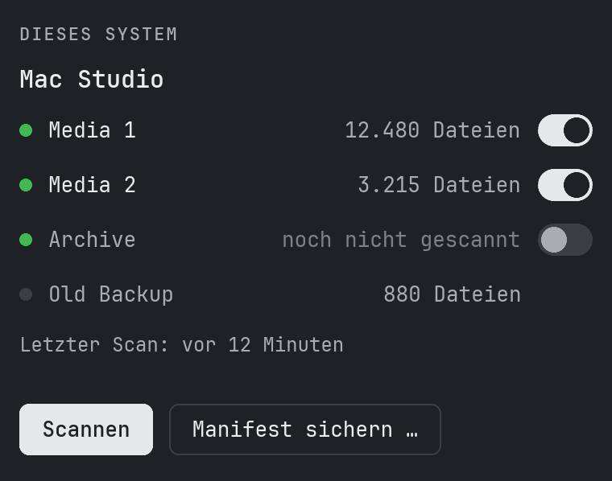
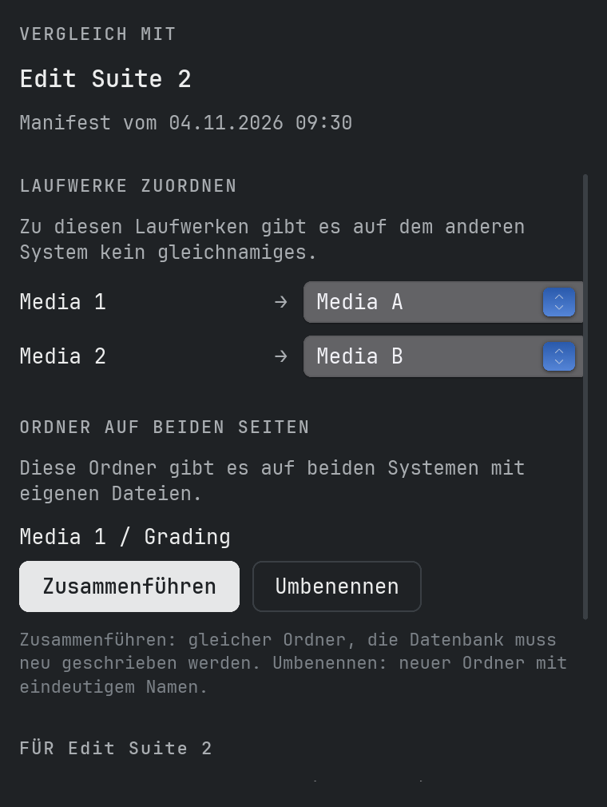
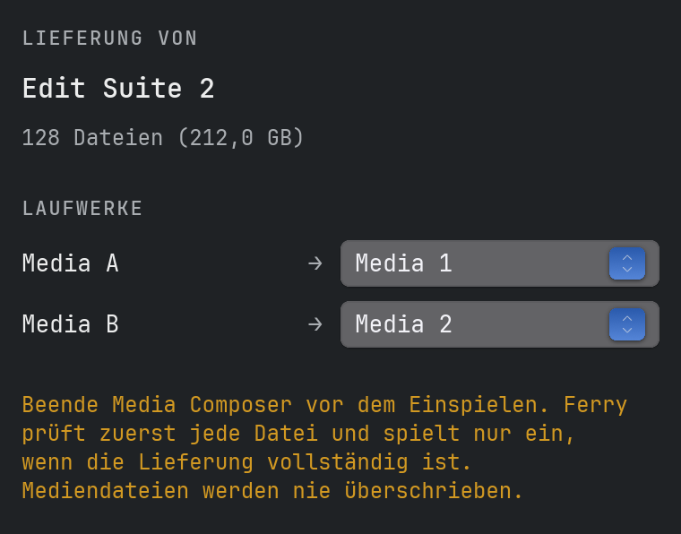
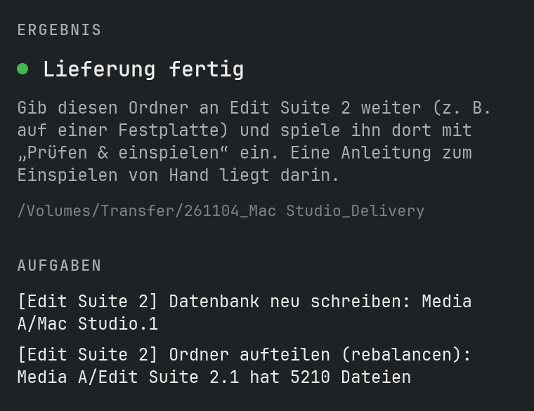
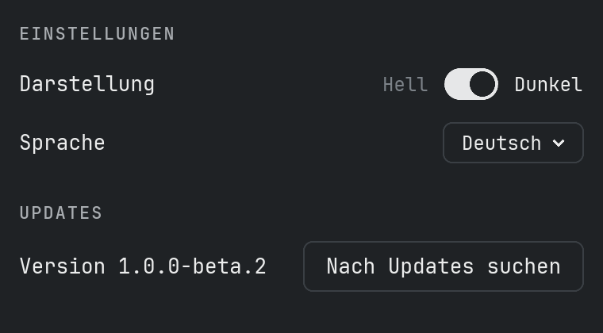

# Anleitung

## Was MediaFiles Ferry macht

MediaFiles Ferry hält die Avid-Mediendateien (MXF) mehrerer Schnittplätze auf demselben Stand, auch wenn die Systeme nicht miteinander verbunden sind. Ferry vergleicht die Bestände, sammelt die fehlenden Dateien in einem Lieferordner und spielt diesen auf dem anderen System sicher ein.

Ferry **löscht nie** Mediendateien und **überschreibt nie** eine vorhandene Mediendatei.

## So funktioniert es

1. **Scannen** auf jedem System. Ferry erfasst jede MXF-Datei mit Prüfsumme und schreibt eine kleine *Manifest*-Datei – eine Liste der Dateien, keine Medien.
2. **Austauschen:** Die Manifeste werden zwischen den Systemen ausgetauscht, z. B. per Mail oder USB-Stick.
3. **Sammeln:** Jedes System sammelt die Dateien, die dem anderen fehlen, in einem Lieferordner.
4. **Prüfen & einspielen:** Der Lieferordner wird auf dem anderen System geprüft und eingespielt.

## Was Ferry erwartet

Auf jedem Laufwerk, auch auf Netzlaufwerken:

- `Avid MediaFiles/MXF/<Ordner>/` mit den `.mxf`-Mediendateien
- die beiden Avid-Datenbankdateien `msmFMID.pmr` und `msmMMOB.mdb` in jedem Ordner
- `Creating`-Ordner werden ignoriert

Ordnernamen sind beliebig, z. B. `1`, `Avid8.1` oder `Mac Studio.1`.

## Scannen

Auf **Scannen** klicken. Ferry findet alle angeschlossenen Laufwerke mit `Avid MediaFiles/MXF` und berechnet für jede MXF-Datei eine Prüfsumme. Der Schalter neben einem Laufwerk bestimmt, ob es gescannt wird – schalte z. B. Backup-Laufwerke aus, die nicht ins Manifest sollen. Neue Laufwerke sind eingeschaltet; Ferry merkt sich die Auswahl.

- **Der erste Scan dauert**, weil jede Datei einmal gelesen wird.
- **Weitere Scans sind schnell:** Ferry merkt sich die Prüfsummen und liest nur neue oder veränderte Dateien.
- Wird die App während eines Scans geschlossen oder stürzt sie ab, geht nichts verloren – der nächste Scan macht dort weiter.

Danach auf **Manifest sichern…** klicken und die Datei an das andere System schicken. Der Dateiname enthält Datum, Uhrzeit und Rechnername, z. B. `261101-1312_Mac Studio_Manifest.ferry`.

## Vergleichen und sammeln

1. Zuerst dieses System scannen, damit das eigene Manifest aktuell ist.
2. Auf **Manifest öffnen…** klicken und das Manifest des anderen Systems wählen.
3. **Laufwerke zuordnen:** Laufwerke ohne gleichnamiges Gegenstück brauchen ein Ziel – oder **Nicht senden**. Ferry merkt sich die Wahl für dieses System.
4. **Ordner auf beiden Seiten:** Für jeden Ordner **Zusammenführen** oder **Umbenennen** wählen (siehe unten).
5. Anzahl der Dateien und Aufgaben prüfen, dann auf **Sammeln…** klicken und wählen, wo der Lieferordner entstehen soll – z. B. auf einer externen Festplatte.

Ferry kopiert jede Datei mit Prüfsummen-Kontrolle in einen neuen Ordner wie `261102-1830_Mac Studio_to_MacBook`. Darin liegt auch `Aufgaben.txt` mit einer Anleitung zum Einspielen von Hand. Wird das Sammeln unterbrochen, macht ein erneutes Sammeln dort weiter.

## Anforderungen aus MediaFiles Check

MediaFiles Check findet Mediendateien, die die Bins von Avid-Projekten brauchen, die das System aber nicht hat, und sichert sie als Anforderung (`…_Request.ferry`). Auf dem System, das die Medien hat:

1. Zuerst dieses System scannen, damit dein Manifest aktuell ist.
2. Auf **Manifest öffnen…** klicken und die Anforderung wählen – Ferry erkennt sie von selbst.
3. Ferry sucht die angeforderten Dateien in den Avid-Datenbanken seiner Laufwerke und zeigt, wie viele es gefunden hat. Dateien, die es nicht findet, stehen in einer Aufgabe zusammen mit den Clips, die sie nutzen.
4. Auf **Sammeln…** klicken. Die Lieferung ist eine ganz normale: Spiele sie auf dem anfordernden System mit **Prüfen & einspielen** ein. Es werden nur Mediendateien geschickt, nie eine Datenbank – die Aufgabenliste nennt die Ordner, die dort eine neue Datenbank brauchen.

## Prüfen und einspielen

1. Media Composer beenden.
2. Auf **Prüfen & einspielen…** klicken und den Lieferordner wählen.
3. Laufwerke prüfen: Jedes Laufwerk der Lieferung braucht ein Laufwerk auf diesem System. Gleichnamige werden automatisch zugeordnet.
4. Auf **Prüfen & einspielen** klicken. Ferry prüft zuerst jede Datei der Lieferung. Nur wenn alles vollständig und unbeschädigt ist, wird eingespielt – Ferry fügt nur hinzu und überschreibt nie eine Mediendatei. Ersetzte Datenbanken landen in `Avid MediaFiles/Ferry-Backup/`.
5. Danach neu scannen, damit das Manifest aktuell ist.

## Wann wird was kopiert?

Eine Datei gilt als **vorhanden**, wenn sie irgendwo auf dem anderen System mit gleichem Namen und gleicher Prüfsumme liegt – auf jedem Laufwerk, in jedem Ordner.

- **Ordner auf beiden Seiten identisch:** Es passiert nichts.
- **Ordner fehlt auf der anderen Seite:** Der ganze Ordner wird kopiert, samt Datenbank.
- **Eine Seite hat zusätzliche Dateien:** Dateien und Datenbank der volleren Seite werden kopiert.
- **Beide Seiten haben eigene Dateien:** Nur die Dateien werden kopiert, keine Datenbank – es entsteht die Aufgabe „Datenbank neu schreiben“.
- **Gleicher Dateiname, anderer Inhalt:** Wird nicht kopiert – eine Aufgabe fordert zum Prüfen auf.

**Grundregel:** Eine Datenbank wird nur mitgeliefert, wenn der Zielordner danach exakt dem Quellordner entspricht. Ferry löscht nie eine Datenbank.

## Laufwerke und gleichnamige Ordner

Laufwerke mit gleichem Namen werden automatisch einander zugeordnet, sonst fragt Ferry nach.

Avid legt auf jedem System Ordner wie `1` an. Gibt es einen solchen Ordner auf beiden Seiten mit unterschiedlichen Dateien, entscheidest du:

- **Zusammenführen:** Die Dateien kommen in denselben Ordner; danach muss die Datenbank neu geschrieben werden.
- **Umbenennen:** Die Dateien kommen in einen neuen Ordner wie `261031_MacStudio_1`.

## Aufgabenliste

Was Ferry nicht selbst erledigen darf, landet in der Aufgabenliste (auch in `Aufgaben.txt` jeder Lieferung). In eckigen Klammern steht das System, auf dem die Aufgabe zu erledigen ist.

- **Datenbank neu schreiben** – im Ordner liegen Dateien, die die Datenbank nicht kennt. In Media Composer neu aufbauen lassen.
- **Ordner aufteilen (rebalancen)** – der Ordner hat mehr als 5000 Dateien; Avid wird langsam. Dateien auf mehrere Ordner verteilen.
- **Gleicher Name, anderer Inhalt** – zwei verschiedene Dateien heißen gleich. Prüfen, welche richtig ist.
- **Doppelte Dateien** – dieselbe Datei liegt in mehreren Ordnern. Kein Fehler, kostet aber Platz.

## Von Hand einspielen

1. Media Composer schließen.
2. Für jeden Ordner der Lieferung auf dem Laufwerk `Avid MediaFiles/MXF/<Ordner>` öffnen (fehlt er, neu anlegen).
3. **Nur den Inhalt des Lieferordners hineinkopieren – niemals den ganzen Ordner auf einen bestehenden Ordner ziehen!** Finder und Explorer ersetzen ihn sonst samt allen Mediendateien.
4. Fragt das System, ob `.mxf`-Dateien ersetzt werden sollen: **nicht ersetzen**, abbrechen und prüfen.
5. `msmFMID.pmr` und `msmMMOB.mdb` nur in den Ordnern ersetzen, die in `Aufgaben.txt` (englisch: `Tasks.txt`) stehen.

## Einstellungen

**MediaFiles Ferry → Einstellungen…** (⌘,) stellt die Darstellung (hell oder dunkel) und die Sprache ein. **MediaFiles Ferry → Über MediaFiles Ferry** zeigt Version und Lizenz.

## Updates

Ferry sucht kurz nach dem Start und alle 6 Stunden auf GitHub nach einer neuen Version; **Einstellungen… → Nach Updates suchen** sucht sofort. Eine neue Version erscheint oben im Hauptfenster: **Neuigkeiten** öffnet die Versionshinweise, **Update installieren** lädt sie, prüft, dass sie vollständig und unverändert ist, legt die alte Version in den Papierkorb und startet Ferry neu.
